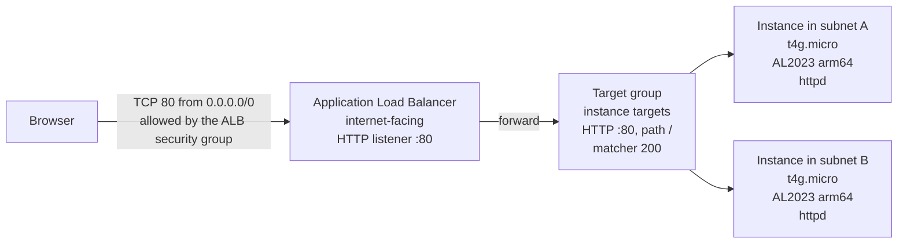
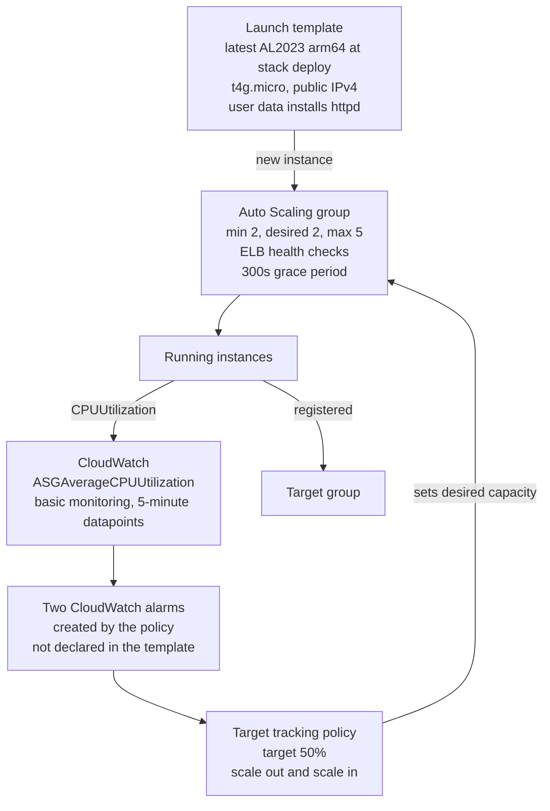

# ASG + ALB + CPU target tracking 

The load balancer spreads HTTP across two instances, and a target-tracking policy keeps the group's average CPU near 50% by changing the desired count between 2 and 5.

---

## Diagram — request path



The instance security group allows TCP 80 only from the ALB security group. A public IP on the instance does not make the page reachable by pasting the instance IP. The page is reachable on the load balancer DNS name.

Both instances sit in the subnets you pass in. Those subnets should be public, in two Availability Zones, because the template assigns a public IPv4 address and does not build a NAT gateway.

## Diagram — who keeps the CPU near 50%



Target tracking is the thermostat. You set 50%. Auto Scaling creates the alarms and changes desired capacity when the group average moves away from 50%. The template does not contain `AWS::CloudWatch::Alarm` resources.

---

## What the template creates

| Resource | Name | What to point at |
|---|---|---|
| `ALBSecurityGroup` | stack-generated | Ingress TCP 80 from `0.0.0.0/0` |
| `InstanceSecurityGroup` | stack-generated | Ingress TCP 80, source = ALB security group |
| `LoadBalancer` | `{StackName}-alb` | Internet-facing, the subnets you selected |
| `TargetGroup` | `{StackName}-tg` | HTTP 80, health check `/` every 30 seconds, HTTP 200 |
| `Listener` | — | Port 80 forwards to the target group |
| `LaunchTemplate` | `{StackName}-lt` | `t4g.micro`, ARM AMI, public IP, user data |
| `AutoScalingGroup` | `{StackName}-asg` | Min 2, max 5, desired 2, health check type `ELB`, grace 300 seconds |
| `CPUScalingPolicy` | stack-generated | `TargetTrackingScaling`, metric `ASGAverageCPUUtilization`, target `50.0` |

Output `LoadBalancerDNS` is the URL you open.

Parameters you must supply: `VpcId`, and `SubnetIds` (at least two, two Availability Zones). `LatestArmAmiId` has a default and resolves through SSM.

---

## Overall Scenario

1. "The browser only talks to the load balancer. The instances only accept port 80 from that load balancer."
2. "Each instance paints a random color and prints its instance ID and Availability Zone. Refresh the page. A different color means a different target."
3. "The group starts at 2 and is allowed to go to 5. It will not go below 2, even if CPU is near zero."
4. "Health for replacement is the load balancer health check, not only the EC2 status check. A machine that is 'running' and not serving HTTP gets replaced after the grace period."
5. "We did not write CloudWatch alarms. The target-tracking policy writes them. The target is 50% average CPU for the group."
6. "CPU here is a 5-minute metric. This demo shows the wiring. It does not show a scale-out in the next minute."

---

## Deployment

Deploy in the instructor demo account. Stack name **28 characters or fewer**. The load balancer name is `{StackName}-alb`, and that name is limited to 32 characters.

```bash
aws cloudformation deploy \
  --template-file /Users/skepil/src/aws-samples/cloudformation/asg-alb-cpu-scaling.yaml \
  --stack-name asg-alb-cpu-demo \
  --parameter-overrides \
      VpcId=vpc-xxxxxxxx \
      SubnetIds=subnet-aaaaaaaa,subnet-bbbbbbbb \
  --region us-east-1
```

`CREATE_COMPLETE` means the group exists. It does not mean the page works yet. User data runs `dnf update` and installs `httpd`. Wait until both targets are **healthy**, then open the DNS name.

Console path after deploy:

1. CloudFormation → stack → **Outputs** → `LoadBalancerDNS`.
2. EC2 → **Target Groups** → `{StackName}-tg` → Targets. Both healthy, two Availability Zones.
3. EC2 → **Auto Scaling Groups** → `{StackName}-asg`. Min 2, desired 2, max 5. Activity tab shows the launches.
4. Same group → **Automatic scaling**. Policy type Target tracking, metric Average CPU utilization, target 50.
5. CloudWatch → **Alarms**. Two alarms whose names start with `TargetTracking-{StackName}-asg`.

Open the DNS name in a browser. Refresh several times. Read the instance ID and the AZ out loud.

---

## Walk the resources in this order

### 1. Security groups

Show the ALB group first: the internet is allowed on 80. Then the instance group: the only source is the ALB group ID. That is the pattern you want them to copy. Opening port 80 to `0.0.0.0/0` on the instances would make the load balancer optional, and the demo would hide it.

### 2. Load balancer, listener, target group

Listener :80, one action, forward. Target group: instance type, path `/`, interval 30 seconds, success code 200. Consecutive successes before a target is healthy stay at the ALB default of **5**. The template does not set that number. Five intervals of 30 seconds is about **150 seconds** after `httpd` answers, on top of package install.

Cross-zone load balancing is on for an Application Load Balancer by default. Each instance can receive traffic from both load balancer nodes.

### 3. Launch template and user data

- Instance type `t4g.micro` is Graviton (arm64). The AMI parameter is the public SSM path `/aws/service/ami-amazon-linux-latest/al2023-ami-kernel-6.1-arm64`.
- CloudFormation resolves that SSM parameter **when the stack is created or updated**. Later scale-outs keep using the AMI ID baked into the launch template. "Latest" does not float on every launch. A newer AMI means a stack update.
- User data enables `httpd`, takes an IMDSv2 token, and writes `index.html` with a random background color, the instance ID, and the AZ. Logs go to `/var/log/user-data.log`. The template has no key pair and no IAM role, so you cannot read that file from the classroom unless you add access before class.
- `NetworkInterfaces` is how the template turns on a public IP and attaches the instance security group. The security group is inside that block. Putting `SecurityGroupIds` at the launch-template root at the same time is invalid.

### 4. Auto Scaling group

| Setting | Value in this template | Line to say |
|---|---|---|
| Min / desired / max | 2 / 2 / 5 | The floor is 2 because you want a page in each subnet even when idle. |
| Launch template version | `LatestVersionNumber` | A stack update that changes the template publishes a new version, and the group uses it for the next launch. |
| `HealthCheckType` | `ELB` | Unhealthy in the target group becomes an Auto Scaling replacement. |
| `HealthCheckGracePeriod` | 300 seconds | Bootstrap is invisible to health checks for 5 minutes. `dnf update` can use most of that. |

There is no `CreationPolicy` and no `UpdatePolicy`. CloudFormation will not wait until the targets are healthy.

### 5. Target tracking policy

| Setting | Value |
|---|---|
| `PolicyType` | `TargetTrackingScaling` |
| Metric | `ASGAverageCPUUtilization` |
| `TargetValue` | `50.0` |
| Scale-in | left on (the template does not set `DisableScaleIn`) |
| `EstimatedInstanceWarmup` | not set |

Warmup falls back to the group's default instance warmup. This group does not set one, so the value falls back to the **default cooldown of 300 seconds**. During warmup, a new instance's CPU does not drive another scale-out.

The group uses **basic monitoring**. `CPUUtilization` arrives every **5 minutes**. The launch template does not enable detailed monitoring. Say that before anyone asks why the alarm is still green after they refresh the page fifty times. Refreshing a static page does not move average CPU in a way this policy will act on during a demo.

---

## What you will get

- Two healthy targets, two AZs, two colors.
- The security group source is the ALB, not the internet.
- The scaling policy and the two alarms Auto Scaling created.
- Min 2 still holds when CPU is low. Scale-in cannot go under the minimum.


- There is no SSM role, no key pair, and no CPU-burn endpoint, so you cannot put load on the instances from the laptop.
- With 5-minute metrics, a real scale-out is a coffee break, then another one for scale-in. Scale-in waits until the metric stays under the target, and it will not cross below min size 2.


---

## Stalls

| What you see | What it is |
|---|---|
| Stack failed on the load balancer or target group name | Stack name plus `-alb` exceeded 32 characters. Use a shorter name. |
| "At least two subnets in two Availability Zones" | `SubnetIds` were in the same AZ, or only one subnet was passed. |
| Instances launch, targets stay initial or unhealthy, then get replaced | User data has not finished `dnf` and `httpd` inside the 300 second grace period, or the instance cannot reach the Amazon Linux repositories (subnet has a public IP and a route to an internet gateway). |
| Browser times out on the instance's public IP | Expected. Port 80 on the instance is open only to the ALB security group. Use `LoadBalancerDNS`. |
| Page never changes color | You may be hitting the same target. Refresh again, or open a private window. The target group is HTTP, so the browser is not pinned by a cookie in this demo. |
| Alarm stays OK during the demo | Expected on basic monitoring with an idle static page. Show the alarm configuration. Do not generate load you cannot reach. |
| `t3` or `t2` substituted in the template | Those are x86. This AMI is arm64. The instance type and the AMI architecture have to match. |

---

## Teardown

Delete the stack the same day. The instances are small. The load balancer is the charge that continues until the stack is gone.

```bash
aws cloudformation delete-stack \
  --stack-name asg-alb-cpu-demo \
  --region us-east-1
```

Confirm the load balancer, the target group, the Auto Scaling group, and both security groups are gone. Target-tracking alarms are deleted with the policy.

---
